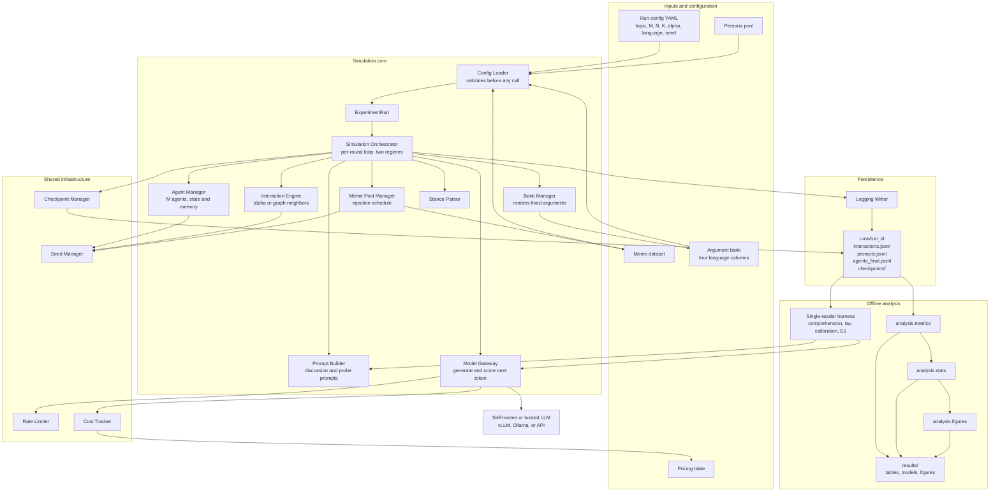
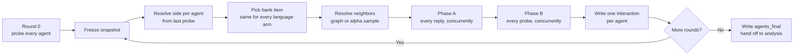

# Chorus: Agentic Network Orchestration and Analysis


Chorus is a Python research harness for simulating populations of LLM-backed
agents that discuss a topic over multiple rounds. You control the social
network, the strength of the echo chamber, the language each agent uses, and
whether memes enter the conversation. The harness records every prompt, reply,
and stance reading so you can study how opinions form, spread, harden, and
polarize.

It is built around three research questions that share one simulation engine.
Inference runs on self-hosted open-weight models through vLLM or Ollama, so a
campaign costs GPU time and no per-token API fees.

## Contents

1. [Overview and Motivation](#1-overview-and-motivation)
2. [HLD Architecture Diagram](#2-hld-architecture-diagram)
3. [Main Components](#3-main-components)
4. [Research Questions](#4-research-questions)
5. [Running the Project](#5-running-the-project)
6. [Testing](#6-testing)
7. [Repository Layout](#7-repository-layout)
8. [Design Principles](#8-design-principles)
9. [Outputs and Reproducibility](#9-outputs-and-reproducibility)
10. [Known Limitations](#10-known-limitations)
11. [Documentation](#11-documentation)
12. [License](#12-license)

## 1. Overview and Motivation

Online discussion does not happen in a vacuum. What we believe is shaped by
who we read, the language they write in, and what kind of content reaches us
first. These forces are hard to separate in real data: a post that changes
minds is usually a post written for a particular audience, delivered through a
particular network, in a particular style.

Chorus makes each of these forces an explicit, controllable variable. It builds
a population of agents, gives each one a persona and a starting position, wires
them into a social network, and then lets them read and reply over several
rounds. Because the harness controls the network, the language, and the content
independently, an observed change can be tied to the thing that was varied.

The project has four goals:

- **Measure persuasion without contamination.** In the bank regime, posts come
  from a fixed argument bank translated into four language conditions. The
  argument is identical across arms, so a difference in how far readers move
  can be attributed to the rendering and not to a different argument. Stance is
  read by a separate probe call, so no agent ever sees its own position number.
- **Study a population, not one conversation.** Agents read a sample of
  neighbors each round, so opinion change can be observed as a network process
  rather than as a single response to a single message.
- **Separate language from script where the design allows it.** The four
  conditions are English, Hinglish, Hindi in Roman script, and Hindi in
  Devanagari. This is not a 2 x 2 crossing of language against script, so the
  contrasts have to be read pairwise: `romanized_hindi` against `hindi` holds
  the language fixed and varies only the script, while `english` against
  `hinglish` varies the language mix at a fixed script. The other pairs move
  both at once and cannot separate the two.
- **Make every run reproducible.** All random draws come from seeded
  generators, including the seed sent to the provider for a bank reply. Every
  run checkpoints each round, and two runs that differ only in language share
  the same graph, neighbor draws, and bank items. A resumed run reproduces an
  uninterrupted one exactly in every draw this process makes; whether the
  replies themselves match depends on the server honoring the seed, which has
  not been checked against a live vLLM endpoint yet.

The result is a small, auditable experimental system. A completed run is a
directory of JSONL records, and every analysis module reads only that output,
never the simulator. Changing an analysis can never change a dataset.

## 2. HLD Architecture Diagram



The system is built as strict dependency tiers. A module only depends on the
tiers below it, never sideways or up. The orchestrator is the only module that
calls every other component, and the analysis package is downstream of a
finished run and nothing else.

The editable PlantUML source for the older rendered diagrams lives in
[`Architecture-docs/plantuml/`](Architecture-docs/plantuml/). A rendered
high-level diagram is also available at
[`agentic-network.png`](agentic-network.png).

### The simulation loop



Two properties of this loop matter for every result:

- **The snapshot is frozen before dispatch.** Neighbor and meme decisions are
  all made before any agent speaks, so no agent's output from round `t` can be
  read by another agent's round `t` decision. The codebase calls this Fix F.
- **No number reaches an agent.** In the bank regime, side and stance are
  internal to the orchestrator. Agents see arguments and persona, not positions
  or agent ids. The probe is a separate call and never enters an agent's
  history.

## 3. Main Components

The `sandbox/` package has 18 modules across four dependency tiers.

| Tier | Modules | Responsibility |
|---|---|---|
| Tier 0 | `models.py`, `config_loader.py`, `seed_manager.py`, `cost_tracker.py`, `rate_limiter.py`, `probe_scorer.py` | Data models and standalone infrastructure |
| Tier 1 | `agent_manager.py`, `meme_pool_manager.py`, `model_gateway.py`, `bank_manager.py` | Population, content, and provider access |
| Tier 2 | `interaction_engine.py`, `stance_parser.py`, `vision_fallback.py`, `logging_writer.py`, `checkpoint_manager.py` | Independent building blocks used by the loop |
| Tier 3 | `simulation_orchestrator.py`, `prompt_builder.py`, `single_exposure.py` | The integration layer |

### Tier 0: models and infrastructure

- **`models.py`** defines every Pydantic v2 model: agents, runs, interactions,
  meme content, checkpoints, and the field constraints that make invalid states
  hard to represent.
- **`config_loader.py`** parses a YAML config into an `ExperimentRun`. It
  validates the whole config before any model call, including referenced files
  and, for the bank regime, every cell of every argument bank.
- **`seed_manager.py`** provides independently seeded random streams for
  neighbor sampling, meme injection, persona assignment, per-turn draws, and
  provider call seeds. No stream takes language or condition as input.
- **`cost_tracker.py`** prices each call from `pricing_table.yaml` and enforces
  an optional run ceiling. A missing price raises instead of guessing.
- **`rate_limiter.py`** throttles requests per provider with a token bucket. An
  unconfigured provider is treated as unlimited.
- **`probe_scorer.py`** turns the probe's top-token logprobs over the digits 1
  to 7 into a continuous stance reading. It is pure arithmetic with no I/O. A
  token counts as a digit by `isdecimal`, not `isdigit`: superscripts pass
  `isdigit` and crash `int()`, and one appearing in a live run's top-k did.
  Digits of other scripts are decimal and are counted deliberately, since
  dropping a Devanagari `४` would lower the probe mass in the Hindi arm
  alone -- a per-arm difference in the instrument itself.

### Tier 1: population, content, and providers

- **`agent_manager.py`** creates and holds the agent population. It assigns
  personas and starting positions, applies interactions, and maintains each
  agent's stance history plus the generated regime's five-turn
  `memory_window`. The bank regime does not use that window: it keeps full
  history by default (`memory_rounds: null`), since a window would bound the
  effect the experiment can measure.
- **`meme_pool_manager.py`** loads the meme dataset and decides, per eligible
  agent and round, whether that agent posts a meme. A meme turn uses the
  dataset's stance label and makes no LLM call.
- **`model_gateway.py`** is the single async interface to every provider,
  backed by LiteLLM. It exposes `generate()` for text and multimodal replies
  and `score_next_token()` for the RQ1 probe, sharing the concurrency cap, rate
  limiter, retry policy, and cost record.
- **`bank_manager.py`** holds the fixed argument bank. Its `pick` function is a
  pure function of seed, sender, side, and how many items that sender has
  already posted on that side. Language never enters the draw. The same class
  loads the neutral bank for the E4 control and the starter bank for
  `start_mode: posts`, whose `starter_items` draw is likewise a pure function
  of seed, reader key, and lean, so the four arms show the same starter posts
  in four renderings.

### Tier 2: reusable building blocks

- **`interaction_engine.py`** provides two neighbor strategies. `AlphaSampling`
  blends uniform random selection with stance-similarity weighting, and
  `GraphSampling` samples from a fixed Watts-Strogatz social graph. RQ1 uses
  the graph so that who an agent reads is structural rather than a function of
  where it stands.
- **`stance_parser.py`** extracts a stance value and reason text from raw model
  output. It is pure and stateless. The orchestrator owns the retry loop.
- **`vision_fallback.py`** substitutes a caption-only prompt when a meme would
  reach a text-only backend, so the instruction framing does not change.
- **`logging_writer.py`** writes the run's append-only JSONL files. A disk
  write failure is fatal and propagates.
- **`checkpoint_manager.py`** saves full agent state after each round and loads
  it on resume. Writes go through a temporary file and an atomic rename.

### Tier 3: integration

- **`simulation_orchestrator.py`** runs the per-round loop. It freezes the
  snapshot, resolves neighbors and meme assignments, dispatches all agents
  concurrently, handles per-agent failures, writes records, applies successful
  updates, and checkpoints.
- **`prompt_builder.py`** builds every discussion and probe prompt. It is the
  single source of prompt text, and it is where the cross-language invariant
  lives. In the bank regime exactly three things vary across the four arms:
  the rendering of the bank text, the probe question, and the one directive
  line. Everything else -- persona, topic, the starting-position section,
  anchor labels, every heading -- is byte-identical, and an integration test
  compares whole runs line by line to keep it that way. It also renders the
  starting position in whichever form `start_mode` names, identically in
  every reply and probe prompt an agent gets.
- **`single_exposure.py`** is the shared machinery for the three single-reader
  scripts. It guarantees that calibration, E1, and the comprehension check use
  the same prompt builder and probe scorer as the network runs.

### Analysis

The `analysis/` package is RQ1's offline post-hoc stage.

- **`metrics.py`** turns completed runs into tidy tables and classifies every
  round-to-round change against the calibrated `tau` for that language. It
  requires exactly one of `--epsilon` and `--epsilon-from-e4`, and raises
  `MissingTau` for a language with no calibration rather than using another
  arm's.
- **`stats.py`** fits the E1 mixed model and the run-level network contrasts.
  E1 is trial-level. Network runs are run-level and paired by seed. A
  non-converged mixed model falls back to OLS clustered on item, and below ten
  item clusters that fallback reports **point estimates only** -- its variance
  estimate collapsed to a standard error of exactly 0 on a live smoke run with
  two items, making every contrast come out as p = 0. Under the floor, `se`,
  the CI and `p` are written as NaN and nothing rejects.
- **`figures.py`** draws the trajectory, E1, threshold, and instrument figures.

## 4. Research Questions

| Question | What it asks | Status |
|---|---|---|
| **RQ1** | Does the language or script of a post change how much it moves an LLM reader? | Simulation and analysis built and tested; single-reader path smoke-tested against a live server, no full campaign yet |
| **RQ2** | Does the quality of an agent's stance-updating reasoning differ by language, and does it correlate with polarization speed? | Post-hoc on RQ1 data, not yet built |
| **RQ3** | Does injecting memes from a labeled dataset accelerate polarization convergence? | Simulation built, analysis not yet built |

### RQ1: Language and script as a treatment

RQ1 runs in the **bank regime**. Posts come from a fixed CSV of arguments, each
pre-translated into four conditions:

- `english`
- `hinglish` (Hindi-English code-mixed)
- `romanized_hindi` (Hindi written in Roman script)
- `hindi` (Devanagari)

An agent's posted argument is chosen without reference to language, so the same
sender on the same side in its third round posts the same argument in all four
arms. The arms differ in the rendering and nothing else.

Stance is measured by a probe. A fresh context holds the agent's persona, its
starting position, and its history -- all of it by default, or the last
`memory_rounds` rounds if a run asks for a window -- and asks for a single
token on a 7-point scale at temperature 0. The distribution over digits gives
a continuous reading, its mass tells you whether the reading is usable, and
the probe never enters the agent's memory.

RQ1 has three experiments:

- **E1, single exposure.** One reader sees one argument, then is probed. This
  isolates the effect of a single post and provides the manipulation check.
- **E3, network runs.** The full population with the graph strategy.
- **E4, delivery control.** The same network run, but each agent reads neutral
  on-topic messages that take no side, one standing in for each argument it
  would otherwise have received. The stand-in is a pure function of the two
  files' contents, so the control reads the same number of posts and repeats
  one exactly when the treatment would. The mapping is not injective: when the
  neutral bank is smaller than the argument bank it wraps, several arguments
  share a message, and an agent can read the same neutral sentence twice in
  one round. Write one neutral message per bank item if that matters for your
  arm. E4 measures drift when nothing persuasive happened, and its spread
  supplies `epsilon`, the tolerance in the stationarity rule, via
  `--epsilon-from-e4`.

The per-round change threshold is a separate instrument. `calibrate_tau.py`
measures a per-language `tau` from single-reader trials in which no persuasive
content is shown, and `analysis.metrics` classifies every round-to-round change
against it; a change is called a flip only when it clears that language's `tau`
and crosses the midpoint. A run whose language has no calibrated `tau` raises
`MissingTau` rather than borrowing another arm's. So E4 fixes when a trajectory
is called stationary, and `tau` fixes when a step is called a change.

### How an agent's starting position is set

Every agent starts somewhere on the scale, and how that starting point is put
into the prompt turned out to matter more than anything else about the prompt.
`ExperimentRun.start_mode` chooses between three ways of doing it:

| `start_mode` | What the agent is shown | Used for |
|---|---|---|
| `sentence` | A lean sentence rendered from `initial_stance` and the anchor labels, in every reply and probe prompt. The original design, and still the default so every older config means what it meant. | Older configs only |
| `none` | No starting position at all. The reader starts from its persona and the model's own view. | E1 |
| `posts` | Posts the agent "wrote before this discussion", drawn from `starter_bank_path` -- more of them, and more one-sided, the further `initial_stance` sits from 4. | The network runs |

The default is not the recommended setting. A live run found that the probe
reads the lean sentence straight back: at lean 6 every persona answered 7.0
with a standard deviation of 0.03, and at lean 2 about 1.3. Readers start
pinned at the ends of the scale, so an argument has nowhere to move them and
the experiment cannot measure what it exists to measure. `posts` carries the
same starting position as arguments rather than as a statement, so a later
argument competes with it on the same footing; `none` removes it, which is the
cleanest place to ask how far one argument moves one reader.

The starter posts are drawn without replacement within a side and shuffled,
so the order says nothing about which side an agent is on, and the section is
worded as the agent's own posts rather than as something it read. No count, no
position, and no digit appears in it. The starter bank is the same CSV format
as the argument bank and is validated at config load: it must hold at least
three items per side, and it may share no `item_id` with the argument bank,
since an agent shown an argument it had already "posted" would be reading
itself.

The section is byte-identical in every prompt an agent gets, whatever the
mode, for the reason the lean sentence was permanent: a section that changed
between round 0 and round 1 would make the round-0 probe and every later probe
two different instruments, and the step between the first two readings would
partly measure the change of section.

### Why the graph

RQ1 uses the **graph** neighbor strategy so that an agent's feed is not a
function of its current stance. Under alpha sampling, a stance effect and a
selection effect produce the same rows and cannot be separated afterwards.

### RQ2: Reasoning quality

RQ2 is a post-hoc analysis of RQ1's own transcripts. It asks whether the
quality of the reasoning an agent gives while updating its stance differs by
language, and whether that quality correlates with how fast the population
polarizes. The analysis modules for this question are not yet built.

### RQ3: Memes and convergence

RQ3 uses the **generated** regime. On some eligible agent-rounds, the agent's
post is replaced by a meme from a labeled dataset. The meme turn uses the
dataset's stance label and costs no model call. The question is whether meme
presence makes a population converge to a polarized distribution faster than
an otherwise identical text-only run. The rate and schedule are properties of
the run, not of a single agent, so the comparison is always across runs.

### Regimes and strategies

There is one simulation engine, with three independent switches:

| Switch | Values | Meaning |
|---|---|---|
| `regime` | `generated`, `bank` | Who writes the post: the agent or the argument bank |
| `neighbor_strategy` | `alpha`, `graph` | Who an agent reads: similarity-weighted sample or fixed graph |
| `start_mode` | `sentence`, `none`, `posts` | How an agent's starting position enters the prompt (bank regime only) |

The generated regime is the original loop and is what RQ3 uses. The bank regime
is RQ1's instrument. `delivery: off` turns a bank run into the E4 control, and
`start_mode` is rejected outright for the generated regime, where asking for
anything but the default would be a silent no-op rather than a setting.

## 5. Running the Project

### Setup

```bash
git clone git@github.com:ResearchDrafts/Chorus--Agentic-Network-Orchestration-and-Analysis.git
cd Chorus--Agentic-Network-Orchestration-and-Analysis

python3 -m venv .venv
source .venv/bin/activate

pip install -e ".[dev]"
```

Python 3.11 or newer is required. Core dependencies are `pydantic`, `pyyaml`,
`litellm`, `networkx`, `tenacity`, `pandas`, `statsmodels`, `scipy`, and
`matplotlib`.

### Serve a model

On a GPU machine, or in a Colab or Kaggle notebook:

```bash
vllm serve Qwen/Qwen2.5-7B-Instruct --dtype half --port 8000
```

On Kaggle, choose a T4 machine, not a P100, because vLLM needs compute
capability 7.0. Use `--dtype half` because bfloat16 needs 8.0. For RQ3, serve
`Qwen/Qwen2.5-VL-7B-Instruct` so memes reach agents as images.

The quickest path is [`notebooks/chorus_colab.ipynb`](notebooks/chorus_colab.ipynb).
It goes from GPU check to a full campaign and runs on a Colab GPU.

### Run a config

```bash
# Validate the config and print what the run will do, without making calls
python run_simulation.py configs/smoke_test.yaml --dry-run

# Run it for real
python run_simulation.py configs/smoke_test.yaml
```

`configs/example_run.yaml` documents every field. Start with `M=5, K=1` to
check the plumbing before launching a real campaign.

### The RQ1 pipeline

Eight steps, in order, with the generator run twice. Each consumes what the
previous one wrote, and each is resumable.

```bash
# 1. Expand one base config into matched sets for all four languages
python scripts/make_rq1_configs.py --seeds 5 --out configs/rq1/campaign

# 2. Check that the model can read each bank item in each language.
#    This writes runs/comprehension/failed_items.txt.
python scripts/check_comprehension.py --runs-dir runs

# 2a. Point base.yaml's exclude_items_path at that file and regenerate, so the
#     items the model could not read stay out of tau, E1 and E3. Nothing
#     downstream drops them for you.
python scripts/make_rq1_configs.py --seeds 5 --out configs/rq1/campaign

# 3. Measure how far a reading moves when nothing persuasive happened.
#    No --start-mode: tau must be the noise of the same instrument the
#    network runs use, which base.yaml sets to "posts".
python scripts/calibrate_tau.py --runs-dir runs

# 4. Run the single-exposure experiment, on readers with no starting position
python scripts/run_e1.py --runs-dir runs --start-mode none

# 5. Run the network campaign
python scripts/run_campaign.py configs/rq1/campaign --runs-dir runs

# 6. Turn runs into tidy tables, classified against each arm's tau
python -m analysis.metrics --runs-dir runs --tau runs/calibration/tau.json \
        --out results/ --epsilon-from-e4

# 7. Fit the models and report the planned contrasts
python -m analysis.stats --e1 runs/e1/trials.jsonl --results results/ --out results/

# 8. Draw the figures
python -m analysis.figures --results results/ --e1 runs/e1/trials.jsonl \
        --calibration runs/calibration/ --out results/figures/
```

Edit [`configs/rq1/base.yaml`](configs/rq1/base.yaml) before a real campaign.
It is valid on its own, but every value marked PLACEHOLDER is a smoke-test
value -- `M: 8`, `K: 3`, the 4-item `test_bank.csv`, the 3-message
`test_neutral.csv`, the 6-item `test_starter.csv`.

**Re-run step 1 after every edit to `base.yaml`.** The generator is what
expands the base into the campaign, and the committed
`configs/rq1/campaign/` files are the smoke-sized expansion of the current
base; a test asserts they are byte-identical to what the generator produces,
so an edited base with a stale campaign is a campaign nobody can reproduce.
`run_campaign.py` discovers runs from the filenames in that directory, so what
is on disk is what runs.

On seed count: step 1's `--seeds 5` is the shipped default and is one seed
short of what the network contrasts need (see below). Use `--seeds 6` or more
if you want p-values on them.

**On `--start-mode`.** Step 4 overrides the base config's `start_mode` and
step 3 deliberately does not, because the two sweeps want different things
from a reader: `tau` is the noise of the instrument the network runs use and
must match them, while E1 asks how far one argument moves a reader and is
cleanest with no starting position at all. `calibrate_tau.py` records the
mode it calibrated under in `tau.json`, and `analysis.metrics` warns when a
run it is scoring was made under a different one -- `tau` is the noise of one
instrument, and its flips would otherwise be judged against another's.
Neither script will append trials under one mode to a file holding another:
the trial key does not include the mode, so a second pass would see every
trial as done and report the first mode's numbers as the second's. Use a different `--runs-dir`
instead.

**Shrinking a sweep.** Steps 3 and 4 accept `--sample N`, a fixed random
sample of N trials per arm spread over the whole grid. Prefer it to `--limit
N`, which takes the first N trials and so covers only the first item or the
first persona -- fine for a plumbing check, useless for anything read as a
number. The sample is drawn from a fixed seed and depends only on the grid's
length, so all four arms get the same trials and a second pass resumes rather
than widening. `tau.json` is flagged `smoke` when either flag was used, so a
calibration run for a plumbing check cannot be mistaken for a real one.

Four checks matter before believing a result:

- The **manipulation check** in `e1_model.txt`. A strong argument must move an
  English reader further than a weak one.
- The **comprehension pass rate** for each language.
- The **seed count** in every network contrast. With fewer than six seeds the
  smallest attainable two-sided Wilcoxon p value is above 0.05, so no row could
  be significant no matter how large the effect.
- The **model line at the top of `e1_model.txt`**. It says whether you have the
  mixed model, the cluster-robust fallback, or point estimates with no
  inference at all because the sweep ran over too few items. Cluster-robust
  standard errors are known to be too small with few clusters, so read
  anything under about thirty items with care even above the ten-cluster
  floor.

## 6. Testing

```bash
# Full suite
python -m pytest

# One file
python -m pytest tests/test_agent_manager.py

# One test
python -m pytest tests/test_agent_manager.py::test_name -q
```

The suite currently has 917 passing tests. `asyncio_mode = "auto"` is set in
`pyproject.toml`, so async tests run without a marker. Integration tests drive
whole runs against a mocked gateway and compare whole runs line by line to keep
the language arms byte-identical.

## 7. Repository Layout

```
sandbox/              Simulation package, 18 modules across four tiers
analysis/             RQ1 analysis: metrics, statistics, figures
scripts/              RQ1 command-line entry points
tests/                Unit, integration, and end-to-end tests
configs/              Run configs; example_run.yaml documents every field
configs/rq1/          Bank-regime configs and the campaign template
data/bank/            Argument bank, neutral control bank, starter bank
data/memes/           Meme fixtures and their images
data/personas/        Persona fixtures, plain text one per line
notebooks/            Colab notebook for running a campaign on a GPU
outputs/              Collected campaign data, one directory per campaign
runs/                 Simulation output, one directory per run
Architecture-docs/    High-level design, low-level design, PlantUML source
Docs/                 Static documentation site
pricing_table.yaml    Provider and model pricing
run_simulation.py     Launcher for one run from a YAML config
export_csv.py         Export a completed run to analysis CSVs
```

## 8. Design Principles

- **Fail loudly.** Invalid parameters, unknown config keys, missing prices, and
  unreadable data all raise before a run spends time or money. Nothing is
  silently clamped or defaulted.
- **Seeded randomness only.** Every stochastic choice comes from a purpose
  specific random stream derived from the run seed. The global `random` module
  is never used.
- **No condition enters a seed.** A seed is a function of the base seed, not of
  language, topic, or trial. This is what makes a matched set matched.
- **Never lose an agent to a limit.** The bank regime keeps full history by
  default. Running out of context is a loud, run-level failure, not a quiet
  per-agent drop that would remove agents from one language arm only.
- **Keep measurements out of the stimulus.** The probe is a separate call and
  never enters an agent's history. In the bank regime, no position number or
  agent id ever appears in a prompt.
- **Distinguish fatal from recoverable failures.** A gateway or parse failure
  becomes a logged null row for that agent, and the round continues. Any other
  exception aborts the run so a bug is not absorbed as data.
- **Keep analysis downstream.** Nothing the simulator imports reads the
  analysis package, so changing an analysis cannot change a dataset.

## 9. Outputs and Reproducibility

A run writes to `runs/{run_id}/`:

| File | Contents |
|---|---|
| `run_config.json` | The exact validated config for the run |
| `interactions.jsonl` | One record per agent-round, the primary dataset |
| `agents_final.jsonl` | Final state of every agent |
| `prompts.jsonl` | Every prompt, when `log_prompts` is on |
| `graph_edges.csv` | The social graph, under the graph strategy |
| `checkpoints/` | Latest full-state checkpoint for resume |

`export_csv.py` turns a completed run into analysis CSVs, including probe
readings, prompt lengths, exposure counts, and control shadow items.

Resume is exact. A run that stops resumes from its last checkpoint. Per-round
random streams are derived from the seed, purpose, and round, so a resumed
round draws exactly what it would have drawn anyway. To start fresh, change
`run_id` or delete the run directory.

The completed first dataset is kept under `outputs/chorus_run1/`: eight runs
and 8,000 interactions. In general, completed campaigns should be stored under
`outputs/`, since `runs/` is used for active work.

## 10. Known Limitations

- **RQ2 and RQ3 analyses are not built.** There is no coherence scoring,
  code-mix index, sentiment proxy, bimodality analysis, or embedding
  clustering. RQ1's analysis is built and tested, but tested means against
  fixtures and against output the orchestrator produced under the mocked
  gateway, plus the live smoke run described below. It has not been run on a
  full dataset.
- **No full bank-regime campaign has been run.** Two things have met a live
  server. One generated-regime campaign exists -- `outputs/chorus_run1/`,
  eight runs against vLLM serving Qwen2.5-7B-Instruct -- and a bank-regime
  **smoke run** of the single-reader path has since been made against a served
  model on a small draft bank. That smoke run is what found the three defects
  fixed in the two most recent commits: the lean sentence being read back by
  the probe (now `start_mode`), a superscript digit in the probe's top-k
  crashing `int()`, and the cluster-robust fallback reporting a standard error
  of exactly 0 on two item clusters. It was a plumbing check, not a result.
  The network runs (E3 and E4) have still only run against the mocked gateway,
  so the operational numbers remain unknown: how long a matched set takes,
  what `probe_mass` a real model puts on the 1-7 scale at population scale,
  whether the four arms' `tau` come out comparable, and whether vLLM honors
  the reply seed well enough for the resume guarantee to hold end to end.
- **No real experimental materials in the repo.** The argument bank, neutral
  bank, starter bank, probe questions and persona pools on disk are fixtures
  sized for tests, not content written for the study. Every PLACEHOLDER in
  `configs/rq1/base.yaml` points at one of them.
- **One language per run.** The bank regime renders delivered posts in the
  run's language. A mixed-language arm would need the sender recorded per
  delivered item first.
- **Resumed runs can duplicate rows.** The log is written per interaction and
  the checkpoint per round, so a crash mid-round re-logs that round on resume.
  `export_csv.py` deduplicates on read, keeping the later write.
- **Prompt length differs by language.** Measured on `outputs/chorus_run1/`,
  the generated-regime campaign: a mean prompt of 698 tokens in English
  against 809 in Hinglish, a 16% gap that widens to 18% by the final round as
  the memory and neighbour blocks compound. Only those two arms have been
  measured, and Devanagari is the more likely worst case, so treat the Hindi
  arms as unquantified until a real bank-regime run reports them. The bank
  regime narrows the gap, because the delivered posts are now the same
  argument rather than freely written text, but the agents' own replies are
  still free text and full history makes whatever gap remains compound over a
  run. `reply_prompt_tokens` and `probe_prompt_tokens` are logged per call for
  exactly this reason: reporting the gap is part of the result, and
  `max_prompt_tokens` raises rather than letting one arm quietly overflow.
- **The persona pools are small.** `test_pool.jsonl` has 4 personas and
  `pool_20.jsonl` has 20. At `M=100`, each persona is shared by several agents.
- **`check_comprehension.py` ignores two of its own flags.** It takes
  `--sample` and `--start-mode` from the shared argument parser but acts on
  neither, so both are accepted silently and do nothing. Use `--limit` to
  shorten that sweep. Neither flag changes what the check measures -- it reads
  bank items back, not stances -- but a passed `--sample` will not shrink it.

## 11. Documentation

- [`Docs/index.html`](Docs/index.html) is a static documentation site with the
  project structure, architecture, sequence diagrams, and a searchable file
  reference. Open it directly in a browser; no build step is needed.
- [`Architecture-docs/sandbox_hld.md`](Architecture-docs/sandbox_hld.md) is the
  high-level design, including the numbered design fixes referenced throughout
  the code.
- [`Architecture-docs/full_design_doc.md`](Architecture-docs/full_design_doc.md)
  is the module-by-module low-level design.
- [`Architecture-docs/plantuml/`](Architecture-docs/plantuml/) holds the
  editable PlantUML source for the rendered diagrams.
- [`CLAUDE.md`](CLAUDE.md) is the working guide for contributors and coding
  agents, with the current invariants and the reasoning behind them.

The phase-by-phase build log lives in git history. `git log --oneline` walks
the tiers in order, and the commit messages carry the design decisions and the
defects found along the way.

## 12. License

No license has been published for this repository yet. All rights are reserved
by the authors until one is added.
