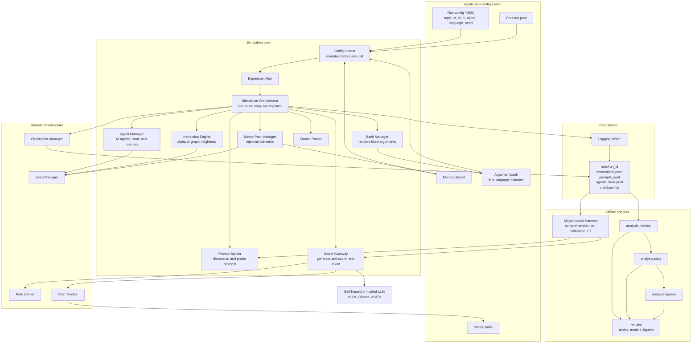
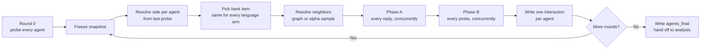

# Chorus: Agentic Network Orchestration and Analysis


Chorus is a Python research harness for simulating populations of LLM-backed
agents that discuss a topic over multiple rounds. You control the social
network, the strength of the echo chamber, the language each agent uses, and
whether memes enter the conversation. The harness records every prompt, reply,
and stance reading so you can study how opinions form, spread, harden, and
polarize.

It is built around three research questions that share one simulation engine.
Inference runs on self-hosted open-weight models through vLLM or Ollama, so a
campaign costs GPU time and no per-token API fees.

## Contents

1. [Overview and Motivation](#1-overview-and-motivation)
2. [HLD Architecture Diagram](#2-hld-architecture-diagram)
3. [Main Components](#3-main-components)
4. [Research Questions](#4-research-questions)
5. [Running the Project](#5-running-the-project)
6. [Testing](#6-testing)
7. [Repository Layout](#7-repository-layout)
8. [Design Principles](#8-design-principles)
9. [Outputs and Reproducibility](#9-outputs-and-reproducibility)
10. [Known Limitations](#10-known-limitations)
11. [Documentation](#11-documentation)
12. [License](#12-license)

## 1. Overview and Motivation

Online discussion does not happen in a vacuum. What we believe is shaped by
who we read, the language they write in, and what kind of content reaches us
first. These forces are hard to separate in real data: a post that changes
minds is usually a post written for a particular audience, delivered through a
particular network, in a particular style.

Chorus makes each of these forces an explicit, controllable variable. It builds
a population of agents, gives each one a persona and a starting position, wires
them into a social network, and then lets them read and reply over several
rounds. Because the harness controls the network, the language, and the content
independently, an observed change can be tied to the thing that was varied.

The project has four goals:

- **Measure persuasion without contamination.** In the bank regime, posts come
  from a fixed argument bank translated into four language conditions. The
  argument is identical across arms, so a difference in how far readers move
  can be attributed to the rendering and not to a different argument. Stance is
  read by a separate probe call, so no agent ever sees its own position number.
- **Study a population, not one conversation.** Agents read a sample of
  neighbors each round, so opinion change can be observed as a network process
  rather than as a single response to a single message.
- **Separate language from script.** The four conditions are English, Hinglish,
  Hindi in Roman script, and Hindi in Devanagari. Language and script are
  varied independently so their effects do not get merged.
- **Make every run reproducible.** All random draws come from seeded
  generators. Every run checkpoints each round. A resumed run produces output
  identical to an uninterrupted one, and two runs that differ only in language
  share the same graph, neighbor draws, and bank items.

The result is a small, auditable experimental system. A completed run is a
directory of JSONL records, and every analysis module reads only that output,
never the simulator. Changing an analysis can never change a dataset.

## 2. HLD Architecture Diagram



The system is built as strict dependency tiers. A module only depends on the
tiers below it, never sideways or up. The orchestrator is the only module that
calls every other component, and the analysis package is downstream of a
finished run and nothing else.

The editable PlantUML source for the older rendered diagrams lives in
[`Architecture-docs/plantuml/`](Architecture-docs/plantuml/). A rendered
high-level diagram is also available at
[`agentic-network.png`](agentic-network.png).

### The simulation loop



Two properties of this loop matter for every result:

- **The snapshot is frozen before dispatch.** Neighbor and meme decisions are
  all made before any agent speaks, so no agent's output from round `t` can be
  read by another agent's round `t` decision. The codebase calls this Fix F.
- **No number reaches an agent.** In the bank regime, side and stance are
  internal to the orchestrator. Agents see arguments and persona, not positions
  or agent ids. The probe is a separate call and never enters an agent's
  history.

## 3. Main Components

The `sandbox/` package has 18 modules across four dependency tiers.

| Tier | Modules | Responsibility |
|---|---|---|
| Tier 0 | `models.py`, `config_loader.py`, `seed_manager.py`, `cost_tracker.py`, `rate_limiter.py`, `probe_scorer.py` | Data models and standalone infrastructure |
| Tier 1 | `agent_manager.py`, `meme_pool_manager.py`, `model_gateway.py`, `bank_manager.py` | Population, content, and provider access |
| Tier 2 | `interaction_engine.py`, `stance_parser.py`, `vision_fallback.py`, `logging_writer.py`, `checkpoint_manager.py` | Independent building blocks used by the loop |
| Tier 3 | `simulation_orchestrator.py`, `prompt_builder.py`, `single_exposure.py` | The integration layer |

### Tier 0: models and infrastructure

- **`models.py`** defines every Pydantic v2 model: agents, runs, interactions,
  meme content, checkpoints, and the field constraints that make invalid states
  hard to represent.
- **`config_loader.py`** parses a YAML config into an `ExperimentRun`. It
  validates the whole config before any model call, including referenced files
  and, for the bank regime, every cell of every argument bank.
- **`seed_manager.py`** provides independently seeded random streams for
  neighbor sampling, meme injection, persona assignment, per-turn draws, and
  provider call seeds. No stream takes language or condition as input.
- **`cost_tracker.py`** prices each call from `pricing_table.yaml` and enforces
  an optional run ceiling. A missing price raises instead of guessing.
- **`rate_limiter.py`** throttles requests per provider with a token bucket. An
  unconfigured provider is treated as unlimited.
- **`probe_scorer.py`** turns the probe's top-token logprobs over the digits 1
  to 7 into a continuous stance reading. It is pure arithmetic with no I/O.

### Tier 1: population, content, and providers

- **`agent_manager.py`** creates and holds the agent population. It assigns
  personas and starting positions, applies interactions, and keeps the bounded
  per-agent memory window.
- **`meme_pool_manager.py`** loads the meme dataset and decides, per eligible
  agent and round, whether that agent posts a meme. A meme turn uses the
  dataset's stance label and makes no LLM call.
- **`model_gateway.py`** is the single async interface to every provider,
  backed by LiteLLM. It exposes `generate()` for text and multimodal replies
  and `score_next_token()` for the RQ1 probe, sharing the concurrency cap, rate
  limiter, retry policy, and cost record.
- **`bank_manager.py`** holds the fixed argument bank. Its `pick` function is a
  pure function of seed, sender, side, and how many items that sender has
  already posted on that side. Language never enters the draw.

### Tier 2: reusable building blocks

- **`interaction_engine.py`** provides two neighbor strategies. `AlphaSampling`
  blends uniform random selection with stance-similarity weighting, and `Graph`
  samples from a fixed Watts-Strogatz social graph. RQ1 uses the graph so that
  who an agent reads is structural rather than a function of where it stands.
- **`stance_parser.py`** extracts a stance value and reason text from raw model
  output. It is pure and stateless. The orchestrator owns the retry loop.
- **`vision_fallback.py`** substitutes a caption-only prompt when a meme would
  reach a text-only backend, so the instruction framing does not change.
- **`logging_writer.py`** writes the run's append-only JSONL files. A disk
  write failure is fatal and propagates.
- **`checkpoint_manager.py`** saves full agent state after each round and loads
  it on resume. Writes go through a temporary file and an atomic rename.

### Tier 3: integration

- **`simulation_orchestrator.py`** runs the per-round loop. It freezes the
  snapshot, resolves neighbors and meme assignments, dispatches all agents
  concurrently, handles per-agent failures, writes records, applies successful
  updates, and checkpoints.
- **`prompt_builder.py`** builds every discussion and probe prompt. It is the
  single source of prompt text. It also enforces the cross-language invariant:
  the prompt differs by exactly one directive line.
- **`single_exposure.py`** is the shared machinery for the three single-reader
  scripts. It guarantees that calibration, E1, and the comprehension check use
  the same prompt builder and probe scorer as the network runs.

### Analysis

The `analysis/` package is RQ1's offline post-hoc stage.

- **`metrics.py`** turns completed runs into tidy tables and classifies every
  round-to-round change against the calibrated threshold for that language.
- **`stats.py`** fits the E1 mixed model and the run-level network contrasts.
  E1 is trial-level. Network runs are run-level and paired by seed.
- **`figures.py`** draws the trajectory, E1, threshold, and instrument figures.

## 4. Research Questions

| Question | What it asks | Status |
|---|---|---|
| **RQ1** | Does the language or script of a post change how much it moves an LLM reader? | Simulation and analysis built |
| **RQ2** | Does the quality of an agent's stance-updating reasoning differ by language, and does it correlate with polarization speed? | Post-hoc on RQ1 data, not yet built |
| **RQ3** | Does injecting memes from a labeled dataset accelerate polarization convergence? | Simulation built, analysis not yet built |

### RQ1: Language and script as a treatment

RQ1 runs in the **bank regime**. Posts come from a fixed CSV of arguments, each
pre-translated into four conditions:

- `english`
- `hinglish` (Hindi-English code-mixed)
- `romanized_hindi` (Hindi written in Roman script)
- `hindi` (Devanagari)

An agent's posted argument is chosen without reference to language, so the same
sender on the same side in its third round posts the same argument in all four
arms. The arms differ in the rendering and nothing else.

Stance is measured by a probe. A fresh context holds the agent's persona, its
lean sentence, and its recent history, and asks for a single token on a 7-point
scale at temperature 0. The distribution over digits gives a continuous
reading, its mass tells you whether the reading is usable, and the probe never
enters the agent's memory.

RQ1 has three experiments:

- **E1, single exposure.** One reader sees one argument, then is probed. This
  isolates the effect of a single post and provides the manipulation check.
- **E3, network runs.** The full population with the graph strategy.
- **E4, delivery control.** The same network run, but each agent reads neutral
  on-topic messages that take no side, one standing in for each argument it
  would otherwise have received. This measures drift when nothing persuasive
  happened and sets the tolerance for every later claim.

The pipeline also calibrates a per-language threshold, `tau`, from trials in
which no persuasive content is shown. A change is called a flip only when it
clears that language's threshold and crosses the midpoint.

RQ1 uses the **graph** neighbor strategy so that an agent's feed is not a
function of its current stance. Under alpha sampling, a stance effect and a
selection effect produce the same rows and cannot be separated afterwards.

### RQ2: Reasoning quality

RQ2 is a post-hoc analysis of RQ1's own transcripts. It asks whether the
quality of the reasoning an agent gives while updating its stance differs by
language, and whether that quality correlates with how fast the population
polarizes. The analysis modules for this question are not yet built.

### RQ3: Memes and convergence

RQ3 uses the **generated** regime. On some eligible agent-rounds, the agent's
post is replaced by a meme from a labeled dataset. The meme turn uses the
dataset's stance label and costs no model call. The question is whether meme
presence makes a population converge to a polarized distribution faster than
an otherwise identical text-only run. The rate and schedule are properties of
the run, not of a single agent, so the comparison is always across runs.

### Regimes and strategies

There is one simulation engine, with two independent switches:

| Switch | Values | Meaning |
|---|---|---|
| `regime` | `generated`, `bank` | Who writes the post: the agent or the argument bank |
| `neighbor_strategy` | `alpha`, `graph` | Who an agent reads: similarity-weighted sample or fixed graph |

The generated regime is the original loop and is what RQ3 uses. The bank regime
is RQ1's instrument. `delivery: off` turns a bank run into the E4 control.

## 5. Running the Project

### Setup

```bash
git clone git@github.com:ResearchDrafts/Chorus--Agentic-Network-Orchestration-and-Analysis.git
cd Chorus--Agentic-Network-Orchestration-and-Analysis

python3 -m venv .venv
source .venv/bin/activate

pip install -e ".[dev]"
```

Python 3.11 or newer is required. Core dependencies are `pydantic`, `pyyaml`,
`litellm`, `networkx`, `tenacity`, `pandas`, `statsmodels`, `scipy`, and
`matplotlib`.

### Serve a model

On a GPU machine, or in a Colab or Kaggle notebook:

```bash
vllm serve Qwen/Qwen2.5-7B-Instruct --dtype half --port 8000
```

On Kaggle, choose a T4 machine, not a P100, because vLLM needs compute
capability 7.0. Use `--dtype half` because bfloat16 needs 8.0. For RQ3, serve
`Qwen/Qwen2.5-VL-7B-Instruct` so memes reach agents as images.

The quickest path is [`notebooks/chorus_colab.ipynb`](notebooks/chorus_colab.ipynb).
It goes from GPU check to a full campaign and runs on a Colab GPU.

### Run a config

```bash
# Validate the config and print what the run will do, without making calls
python run_simulation.py configs/smoke_test.yaml --dry-run

# Run it for real
python run_simulation.py configs/smoke_test.yaml
```

`configs/example_run.yaml` documents every field. Start with `M=5, K=1` to
check the plumbing before launching a real campaign.

### The RQ1 pipeline

Eight commands, in order. Each consumes what the previous one wrote, and each
is resumable.

```bash
# 1. Expand one base config into matched sets for all four languages
python scripts/make_rq1_configs.py --seeds 5 --out configs/rq1/campaign

# 2. Check that the model can read each bank item in each language
python scripts/check_comprehension.py --runs-dir runs

# 3. Measure how far a reading moves when nothing persuasive happened
python scripts/calibrate_tau.py --runs-dir runs

# 4. Run the single-exposure experiment
python scripts/run_e1.py --runs-dir runs

# 5. Run the network campaign
python scripts/run_campaign.py configs/rq1/campaign --runs-dir runs

# 6. Turn runs into tidy tables, classified against each arm's tau
python -m analysis.metrics --runs-dir runs --tau runs/calibration/tau.json \
        --out results/ --epsilon-from-e4

# 7. Fit the models and report the planned contrasts
python -m analysis.stats --e1 runs/e1/trials.jsonl --results results/ --out results/

# 8. Draw the figures
python -m analysis.figures --results results/ --e1 runs/e1/trials.jsonl \
        --calibration runs/calibration/ --out results/figures/
```

Edit [`configs/rq1/base.yaml`](configs/rq1/base.yaml) before a real campaign.
It is valid on its own, but every value marked PLACEHOLDER is a smoke-test
value.

Three checks matter before believing a result:

- The **manipulation check** in `e1_model.txt`. A strong argument must move an
  English reader further than a weak one.
- The **comprehension pass rate** for each language.
- The **seed count** in every network contrast. With fewer than six seeds the
  smallest attainable two-sided Wilcoxon p value is above 0.05, so no row could
  be significant no matter how large the effect.

## 6. Testing

```bash
# Full suite
python -m pytest

# One file
python -m pytest tests/test_agent_manager.py

# One test
python -m pytest tests/test_agent_manager.py::test_name -q
```

The suite currently has 869 passing tests. `asyncio_mode = "auto"` is set in
`pyproject.toml`, so async tests run without a marker. Integration tests drive
whole runs against a mocked gateway and compare whole runs line by line to keep
the language arms byte-identical.

## 7. Repository Layout

```
sandbox/              Simulation package, 18 modules across four tiers
analysis/             RQ1 analysis: metrics, statistics, figures
scripts/              RQ1 command-line entry points
tests/                Unit, integration, and end-to-end tests
configs/              Run configs; example_run.yaml documents every field
configs/rq1/          Bank-regime configs and the campaign template
data/bank/            Argument bank and neutral control bank
data/memes/           Meme fixtures and their images
data/personas/        Persona fixtures, plain text one per line
notebooks/            Colab notebook for running a campaign on a GPU
outputs/              Collected campaign data, one directory per campaign
runs/                 Simulation output, one directory per run
Architecture-docs/    High-level design, low-level design, PlantUML source
Docs/                 Static documentation site
pricing_table.yaml    Provider and model pricing
run_simulation.py     Launcher for one run from a YAML config
export_csv.py         Export a completed run to analysis CSVs
```

## 8. Design Principles

- **Fail loudly.** Invalid parameters, unknown config keys, missing prices, and
  unreadable data all raise before a run spends time or money. Nothing is
  silently clamped or defaulted.
- **Seeded randomness only.** Every stochastic choice comes from a purpose
  specific random stream derived from the run seed. The global `random` module
  is never used.
- **No condition enters a seed.** A seed is a function of the base seed, not of
  language, topic, or trial. This is what makes a matched set matched.
- **Never lose an agent to a limit.** The bank regime keeps full history by
  default. Running out of context is a loud, run-level failure, not a quiet
  per-agent drop that would remove agents from one language arm only.
- **Keep measurements out of the stimulus.** The probe is a separate call and
  never enters an agent's history. In the bank regime, no position number or
  agent id ever appears in a prompt.
- **Distinguish fatal from recoverable failures.** A gateway or parse failure
  becomes a logged null row for that agent, and the round continues. Any other
  exception aborts the run so a bug is not absorbed as data.
- **Keep analysis downstream.** Nothing the simulator imports reads the
  analysis package, so changing an analysis cannot change a dataset.

## 9. Outputs and Reproducibility

A run writes to `runs/{run_id}/`:

| File | Contents |
|---|---|
| `run_config.json` | The exact validated config for the run |
| `interactions.jsonl` | One record per agent-round, the primary dataset |
| `agents_final.jsonl` | Final state of every agent |
| `prompts.jsonl` | Every prompt, when `log_prompts` is on |
| `graph_edges.csv` | The social graph, under the graph strategy |
| `checkpoints/` | Latest full-state checkpoint for resume |

`export_csv.py` turns a completed run into analysis CSVs, including probe
readings, prompt lengths, exposure counts, and control shadow items.

Resume is exact. A run that stops resumes from its last checkpoint. Per-round
random streams are derived from the seed, purpose, and round, so a resumed
round draws exactly what it would have drawn anyway. To start fresh, change
`run_id` or delete the run directory.

The completed first dataset is kept under `outputs/chorus_run1/`: eight runs
and 8,000 interactions. In general, completed campaigns should be stored under
`outputs/`, since `runs/` is used for active work.

## 10. Known Limitations

- **RQ2 and RQ3 analyses are not built.** RQ1's analysis is complete. There is
  no coherence scoring, code-mix index, sentiment proxy, bimodality analysis,
  or embedding clustering yet.
- **No live-server campaign has been run yet.** Every path is exercised against
  a mocked gateway, but operational numbers such as throughput and probe mass
  are still unknown.
- **One language per run.** The bank regime renders delivered posts in the
  run's language. A mixed-language arm would need the sender recorded per
  delivered item first.
- **Resumed runs can duplicate rows.** The log is written per interaction and
  the checkpoint per round, so a crash mid-round re-logs that round on resume.
  `export_csv.py` deduplicates on read, keeping the later write.
- **Prompt length differs by language.** The same content tokenizes less
  efficiently in Hinglish than in English. The bank regime reduces this gap but
  does not remove it. Every call logs its prompt length so the gap can be
  reported rather than hidden.
- **The persona pools are small.** `test_pool.jsonl` has 4 personas and
  `pool_20.jsonl` has 20. At `M=100`, each persona is shared by several agents.

## 11. Documentation

- [`Docs/index.html`](Docs/index.html) is a static documentation site with the
  project structure, architecture, sequence diagrams, and a searchable file
  reference. Open it directly in a browser; no build step is needed.
- [`Architecture-docs/sandbox_hld.md`](Architecture-docs/sandbox_hld.md) is the
  high-level design, including the numbered design fixes referenced throughout
  the code.
- [`Architecture-docs/full_design_doc.md`](Architecture-docs/full_design_doc.md)
  is the module-by-module low-level design.
- [`Architecture-docs/plantuml/`](Architecture-docs/plantuml/) holds the
  editable PlantUML source for the rendered diagrams.
- [`CLAUDE.md`](CLAUDE.md) is the working guide for contributors and coding
  agents, with the current invariants and the reasoning behind them.

The phase-by-phase build log lives in git history. `git log --oneline` walks
the tiers in order, and the commit messages carry the design decisions and the
defects found along the way.

## 12. License

No license has been published for this repository yet. All rights are reserved
by the authors until one is added.
